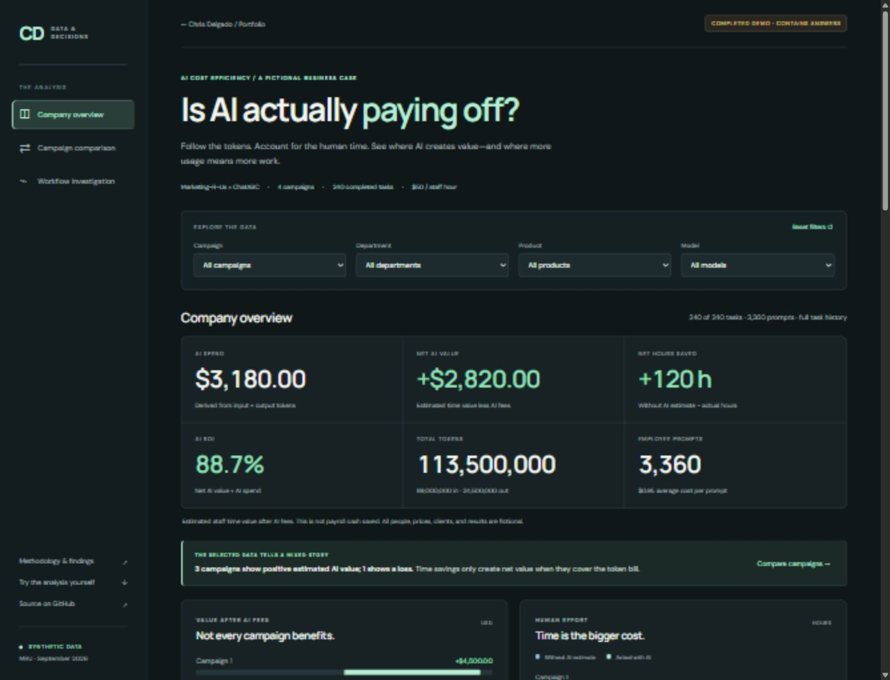

# AI Cost Efficiency

**Does the value of time saved justify the AI bill?** An interactive analytics portfolio project by Chris Delgado, with two standalone learner tracks.

### Completed dashboard — ready for portfolio deployment

[Run the dashboard locally](#run-locally) · [Portfolio handoff](docs/PORTFOLIO_HANDOFF.md) · [Findings and methodology](docs/ANALYSIS.md) · [Download the full learner project](release/mru-portfolio-project.zip?raw=true) · [Download the four-hour challenge](release/mru-quick-challenge.zip?raw=true)

The code and both exercises are published here. Cloudflare publication is being handled separately by the owner; the new dashboard is not live on the portfolio yet.

The dashboard is the completed demonstration. **It contains answers.** Marketing-R-Us, ChatABC, all employees, token prices, and business results are fictional. No real company data, live AI service, account, API key, or billing credentials are used.



## Choose your track

| Track | Audience and effort | What you get | Start here |
| --- | --- | --- | --- |
| **Completed portfolio dashboard** | Explore the finished analysis | Company overview, campaign comparison, workflow investigation, sensitivity analysis, and audit export | [Run locally](#run-locally) · [Dashboard source](dashboard/) |
| **Portfolio learner project** | Intermediate · about 12–16 hours | Four source CSVs, a brief, column guide, formulas, worked illustration, and submission checklist | [Download ZIP](release/mru-portfolio-project.zip?raw=true) · [Read the brief](learners/portfolio-project/README.md) |
| **Quick Challenge** | Beginner / early intermediate · four-hour target | One task CSV and complete Excel-friendly guidance; no joins or programming required | [Download ZIP](release/mru-quick-challenge.zip?raw=true) · [Read the brief](learners/quick-challenge/README.md) |

Unzip either exercise and open **START_HERE.html** for the complete offline guide. Learner archives contain no solved campaign totals, generator, answer key, or finished dashboard. The repository's `author/`, `tests/`, `docs/ANALYSIS.md`, and `dashboard/` contain solution spoilers. The four-hour target has an [author dry-run record](docs/learner-dry-run.md), not a validated beginner completion-time claim.

## The analysis

The synthetic September 2026 dataset has **240 completed tasks and 3,360 prompts**, spanning four campaigns, four departments, four products, two models, and eight fictional employees. The quick track uses the same 120 focal tasks and their underlying prompts, summarized without a file join. Both raw task exports intentionally contain repeated rows and inconsistent department labels.

The dashboard calculates token charges from the source inputs; costs and conclusions are not embedded as campaign constants. It shows input/output spend, human effort, rework, model/product mix, and whole-campaign results. Campaign, department, product, and model controls filter task analysis. Daily dates filter only the prompt-spend chart. Whole-campaign profit and ROI accept only the campaign filter, so partial-task selections cannot misrepresent revenue or profitability.

<details>
<summary>Completed solution highlights — spoilers</summary>

| Measure | Campaign 1 | Campaign 2 |
| --- | ---: | ---: |
| AI token spending | $500 | $1,400 |
| Hours saved against the no-AI estimate | 100 | −70 |
| Estimated net AI value | $4,500 | −$4,900 |
| AI ROI | 900% | −350% |
| Whole-campaign result | $7,500 | −$2,400 |

Both focal net-value conclusions hold when baseline hours change by ±20%. The $9,400 net-value gap comprises $8,500 less time value and $900 more token spending. The entire token-cost increase comes from Pro usage at unchanged prices. These observations support workflow investigation and controlled trials; they do not prove causation.

</details>

## Run locally

For the checked-in dashboard, install **Node.js 22 or newer**. There are no npm dependencies to install.

```sh
git clone https://github.com/GlassHouse97/AI-Cost-Efficiency-Portfolio-Project.git
cd AI-Cost-Efficiency-Portfolio-Project
npm run dev
```

Open **http://127.0.0.1:4327/**. Use `npm run dev -- --port 4328` to choose another port. The preview server binds to localhost. Serve the app over HTTP; directly opening its HTML file cannot load the JSON module data.

To regenerate and validate every data and download artifact, also install **Python 3.10 or newer**. All Python scripts use the standard library.

```sh
python author/generate.py
python author/validate.py --write-checks
python author/package.py
python -m unittest discover -s tests -p "test_data.py" -v
npm test
python author/package.py --check
npm run build
```

`npm run build` produces a static `dist/` folder. The seed is `20261022`; ZIP timestamps and entry ordering are fixed. The independent Python validator recalculates costs using `Decimal`, while the browser calculates charges in integer microdollars and rounds only displayed values. See [author calibration and exact checks](author/CALIBRATION.md) for the audit trail.

## Repository map

```text
dashboard/                   Static HTML/CSS/JavaScript application and clean source JSON
learners/quick-challenge/     One raw CSV and standalone beginner instructions
learners/portfolio-project/  Four raw CSVs and deeper learner instructions
release/                     Ready-to-share, solution-free learner ZIPs
author/                      Deterministic generator, independent validator, ZIP packager
tests/                       Data-integrity and dashboard calculation regression tests
docs/                        Completed analysis, QA record, and deployment instructions
scripts/                     Local preview, static build, and portfolio sync helpers
```

## Technology and delivery

Python prepares and independently verifies the data. The dashboard uses semantic HTML, responsive CSS, dependency-free JavaScript, and SVG charts with readable values and data tables. Keyboard-accessible controls, scoped filter labels, empty states, and a CSV audit export support inspection. Custom fonts are optional Google Fonts assets with local system-font fallbacks; the app itself needs no network service after its static files load.

The existing portfolio uses Astro and Cloudflare Workers. This project is copied into its static assets so the original site remains the deployment owner. See [deployment and update steps](docs/DEPLOYMENT.md). Updating this analysis repository alone does not automatically replace the deployed portfolio copy.

Code and documentation use the [MIT license](LICENSE). Synthetic CSV/JSON data use [CC0 1.0](DATA_LICENSE). Analysis, code, documentation, and validation were prepared with Codex assistance. The learner AI-help guideline is separate and applies to the learner exercise.
