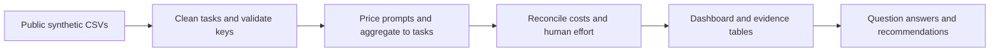

# AI Cost Efficiency & Workflow Value Case Study

**Does the value of staff time saved justify the AI bill?** An interactive analytics portfolio project by Chris Delgado that follows AI tokens through human effort, rework, and campaign results.

**[Open the live dashboard](https://ai-cost-efficiency-860922042669.us-east1.run.app)** · [Read the executive summary](SOLUTION/EXECUTIVE_SUMMARY.md) · [Explore the detailed answers](SOLUTION/README.md) · [Try the learner challenge](#try-the-analysis-yourself)

The dashboard is the main portfolio deliverable. This repository includes its complete source code, public synthetic data, reproducible calculations, dashboard screenshots, and two standalone learner packages.


*Dashboard evidence: September 2026, all four campaigns, all departments, products, and models; original baseline estimates. The company total covers 240 tasks.*

## Start Here

### 1. Explore the completed case study

- **[Live dashboard](https://ai-cost-efficiency-860922042669.us-east1.run.app):** filter the company overview, compare campaigns, investigate workflows, and export calculated task data.
- **[Executive summary](SOLUTION/EXECUTIVE_SUMMARY.md):** read the problem, findings, recommendations, and supporting dashboard images without running code.
- **[Case-study questions and guidelines](CASE_STUDY_QUESTIONS.md):** review the analytical scope and calculation rules.
- **[Detailed answers](SOLUTION/README.md):** follow each question to its result table, screenshot, interpretation, and validation note.

### 2. Understand the business problem

Marketing-R-Us (MRU), a fictional marketing company, uses the fictional ChatABC platform to complete campaign work. Leadership sees more AI usage but needs to know whether staff complete the same work in less time after preparation, review, and corrections. A lower token bill alone is insufficient: an inexpensive workflow can still consume more staff time than it saves.

The case asks where AI creates estimated value, where rework erodes it, and which workflows merit a controlled improvement trial. It also separates **net AI value** from **whole-campaign profit or loss**. Staff time is valued at $50 per hour; that is a capacity-value estimate, not realized payroll cash savings.

All organizations, people, usage records, prices, and financial results are **synthetic and deliberately calibrated for teaching**. They are not anonymized real-company results or current AI vendor prices.

### 3. Reproduce the analysis

The [data guide](data/README.md) links to every source CSV. The [pipeline guide](docs/DATA_PIPELINE.md) explains cleaning, joins, calculation grain, and validation. Local run commands appear [below](#run-and-reproduce-locally).

## Results at a Glance

| Finding | Evidence | What it means |
| --- | --- | --- |
| Company value is positive, but uneven | All four campaigns: $3,180 AI spend, 120 hours saved, **$2,820 net AI value**, 88.68% AI ROI | A company total can hide a workflow that loses value |
| The focal campaigns tell opposite stories | Campaign 1: **+$4,500** net AI value; Campaign 2: **−$4,900** | Prioritize the campaign and task pattern, not AI adoption alone |
| Human effort explains most of their gap | $8,500 of the $9,400 net-value difference comes from estimated time value; $900 comes from AI cost | Improve review and rework alongside model routing |
| Creative leads the focal department comparison | Campaigns 1+2: $498.37 AI spend and **+$381.63 net AI value** | The largest spender can also create the most value |
| Rework is concentrated in Campaign 2 | **87.82 rework hours** versus 10.74 in Campaign 1; 482 versus 68 correction prompts | Investigate changed briefs, corrections, and template use |
| Baseline uncertainty matters | Campaigns 3 and 4 become negative at a 20% lower no-AI baseline | Validate estimates before extending successful-looking workflows |


*Dashboard evidence: Campaigns 1 and 2 only, all departments, products, and models; original baseline. This is the Quick Challenge's 120-task population. Its combined net AI value is −$400, distinct from the all-company +$2,820.*

## Business Questions

These six questions preserve the [Quick Challenge](learners/quick-challenge/README.md) brief. Each answer also includes the relevant deeper-project analysis.

1. [How many input and output tokens did each campaign use, what did they cost, and how many prompts were made?](SOLUTION/01_usage_and_costs.md)
2. [How many hours did each campaign save or lose against its no AI estimate?](SOLUTION/02_time_saved.md)
3. [After paying for AI, was estimated net value positive or negative for each campaign?](SOLUTION/03_value_and_campaign_results.md)
4. [Which department had the highest AI spending, and which had the highest net AI value?](SOLUTION/04_department_analysis.md)
5. [Which campaign had more rework, and which recorded issues appeared most often?](SOLUTION/05_workflow_investigation.md)
6. [Should MRU keep, change, or reduce how it uses AI? Give two actions supported by the numbers.](SOLUTION/06_strategic_recommendations.md)

The deeper track extends these questions with product/model comparisons, similar-task investigations, whole-campaign financial results, and ±20% baseline sensitivity. The [question guide](CASE_STUDY_QUESTIONS.md#deeper-project-questions) maps all six deeper questions to their completed answers.


*Dashboard evidence: Campaign 2 only, all departments, products, models, and task types. Changed briefs are its most common recorded issue: 27 of 60 tasks, with 41.38 rework hours in that group. Associations do not establish causes.*

## Data and Analytical Rules

The reporting month is **September 2026**. The full project has 240 unique completed tasks, 3,360 prompts, four campaigns, four departments, four products, two models, and eight fictional employees. The quick track contains the same 120 focal tasks summarized into a single file.

| Source | Row meaning | Raw rows | Clean rows | Purpose |
| --- | --- | ---: | ---: | --- |
| [work_log.csv](data/portfolio-project/work_log.csv) | One task | 242 | 240 | Baseline, actual and rework hours; workflow observations |
| [ai_usage.csv](data/portfolio-project/ai_usage.csv) | One prompt | 3,360 | 3,360 | Token volume, model, product, and usage date |
| [model_pricing.csv](data/portfolio-project/model_pricing.csv) | One model | 2 | 2 | Fixed fictional input/output token rates |
| [campaigns.csv](data/portfolio-project/campaigns.csv) | One campaign | 4 | 4 | Revenue and other campaign spending |
| [mru_quick_challenge.csv](data/quick-challenge/mru_quick_challenge.csv) | One focal task with aggregated usage | 122 | 120 | Standalone Excel-friendly exercise |

- Remove exact repeated task IDs and standardize department labels. Investigate conflicting keys instead of discarding arbitrary records.
- Price input and output tokens separately, **aggregate prompts to task grain**, then join task hours. Rework is already included in actual hours.
- Calculate `net AI value = (baseline hours − actual hours) × $50 − AI cost`. Calculate ROI from summed net value divided by summed AI cost; do not average task ROIs.
- Count revenue and other spending once per complete campaign. Whole-campaign financial results accept only campaign selection.
- Campaign, department, product, and model filters change task analysis. Prompt dates change the daily-spend chart only; baseline sensitivity changes its scenario table only.
- Preserve the distinction between the **120-task focal analysis** and **240-task company analysis**. Every answer and image labels its scope.

See the [data dictionary](docs/DATA_DICTIONARY.md), [complete methodology](SOLUTION/ANALYSIS.md), and [exact validation controls](SOLUTION/outputs/check_totals.json).

## Try the Analysis Yourself

| Track | Audience and planning target | Download | GitHub guide |
| --- | --- | --- | --- |
| **Quick Challenge** | Beginner / early intermediate; four-hour target; Excel or basic BI; one CSV, no joins | [Download ZIP](release/mru-quick-challenge.zip?raw=true) | [Read the brief](learners/quick-challenge/README.md) |
| **Portfolio Project** | Intermediate; about 12–16 hours; four CSVs; Excel, SQL, BI, or code | [Download ZIP](release/mru-portfolio-project.zip?raw=true) | [Read the brief](learners/portfolio-project/README.md) |

Unzip a package and open **START_HERE.html** for its offline guide. Each ZIP contains the raw data, formulas, column guide, and submission checklist, without completed answers or the dashboard. The public `SOLUTION/`, `dashboard/`, `scripts/`, and `tests/` folders contain spoilers. The timing estimates are planning targets; the [learner dry-run record](docs/learner-dry-run.md) documents the checks performed, not a timed beginner pilot.

## Run and Reproduce Locally

Use **Node.js 22 or newer** to run the dashboard. There are no npm dependencies to install.

```sh
git clone https://github.com/GlassHouse97/AI-Cost-Efficiency-Portfolio-Project.git
cd AI-Cost-Efficiency-Portfolio-Project
npm run dev
```

Open **http://127.0.0.1:4327/**. Add `-- --port 4328` to choose another port. Serve the dashboard over HTTP so it can load its data.

Use **Python 3.10 or newer** to regenerate the data, evidence tables, and learner packages. The Python scripts use the standard library.

```sh
python scripts/generate_data.py
python scripts/validate_data.py --write-checks
python scripts/analyze_case_study.py
python scripts/package_learners.py
python -m unittest discover -s tests -p "test_data.py" -v
npm test
python scripts/package_learners.py --check
npm run build
```

Generation uses seed `20261022`; the validator independently recalculates costs with `Decimal`. The browser retains integer microdollar charges until display. The analysis script rebuilds the compact [CSV evidence tables](SOLUTION/outputs/). `npm run build` produces the static `dist/` dashboard. See the [script guide](scripts/README.md), [validation record](docs/VALIDATION.md), and [Cloud Run deployment guide](docs/DEPLOYMENT.md).

## Pipeline



## Repository Map

```text
.
|-- README.md                         # Dashboard, business story, and navigation
|-- CASE_STUDY_QUESTIONS.md            # Scope, guiding questions, and reporting rules
|-- data/                             # Canonical public source CSVs and data guide
|   |-- portfolio-project/            # Four source tables for all four campaigns
|   `-- quick-challenge/              # One task-level file for Campaigns 1 and 2
|-- dashboard/                        # HTML, CSS, JavaScript, and clean source JSON
|-- docs/                             # Data dictionary, pipeline, QA, and deployment
|-- scripts/                          # Generation, validation, evidence, packaging, server
|-- tests/                            # Data and dashboard calculation tests
|-- learners/                         # Separate quick and deeper exercise instructions
|-- release/                          # Two standalone learner ZIP downloads
`-- SOLUTION/                         # Completed analysis; contains learner answers
    |-- README.md
    |-- EXECUTIVE_SUMMARY.md
    |-- 01_usage_and_costs.md
    |-- 02_time_saved.md
    |-- 03_value_and_campaign_results.md
    |-- 04_department_analysis.md
    |-- 05_workflow_investigation.md
    |-- 06_strategic_recommendations.md
    |-- ANALYSIS.md
    |-- CALIBRATION.md
    |-- outputs/                      # Reproducible CSV evidence and exact controls
    `-- visualizations/               # Screenshots captured from the working dashboard
```

## Technology and Attribution

The dashboard uses HTML, CSS, dependency-free JavaScript, SVG charts, readable data tables, scoped controls, and a CSV audit export. Python generates and verifies the teaching data. Google Cloud Run hosts the completed dashboard; this repository is ready for separate portfolio-site integration using the [handoff guide](docs/PORTFOLIO_HANDOFF.md).

Data generation, analysis, code, documentation, and validation were prepared with **Codex assistance**. The learner exercise's AI-help limits apply to learners, not author preparation. Reconciliation demonstrates internal consistency; synthetic associations do not establish causation, predict performance, or validate a real company's savings.

Code and documentation use the [MIT license](LICENSE). Synthetic data use [CC0 1.0](DATA_LICENSE).
