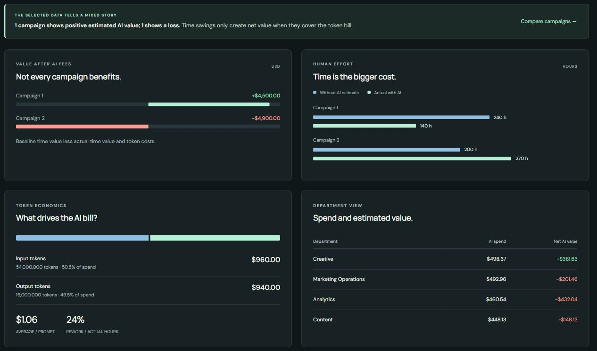

# Question 1: Usage and Costs

**How many input and output tokens did each campaign use, what did they cost, and how many prompts were made?**

## Direct Answer

Campaign 1 uses **27 million tokens across 600 prompts for $500**. Campaign 2 uses **42 million tokens across 1,200 prompts for $1,400**. Campaign 2 doubles the prompt count, increases token volume by 55.56%, and increases cost by 180%. The difference reflects more Pro tokens at unchanged model prices.

## Campaign Results

The first two rows answer the 120-task Quick Challenge. Campaigns 3 and 4 and the company total are the deeper-project extension.

| Campaign | Input tokens | Output tokens | Input cost | Output cost | Total AI cost | Prompts | Cost / prompt |
| --- | ---: | ---: | ---: | ---: | ---: | ---: | ---: |
| Campaign 1 | 22,000,000 | 5,000,000 | $280 | $220 | $500 | 600 | $0.8333 |
| Campaign 2 | 32,000,000 | 10,000,000 | $680 | $720 | $1,400 | 1,200 | $1.1667 |
| Campaign 3 | 18,000,000 | 4,500,000 | $300 | $240 | $540 | 720 | $0.7500 |
| Campaign 4 | 17,000,000 | 5,000,000 | $380 | $360 | $740 | 840 | $0.8810 |
| **All four** | **89,000,000** | **24,500,000** | **$1,640** | **$1,540** | **$3,180** | **3,360** | **$0.9464** |

*Dashboard evidence: Company overview, Campaigns 1 and 2, all departments, products, and models. The token panel combines the focal campaigns: 54 million input tokens costing $960 and 15 million output tokens costing $940.*

## Deeper Analysis: Model and Product Mix

Lite is priced at $10 input / $30 output per million tokens; Pro at $40 / $100. These are fixed fictional rates shared by all four products.

| Model measure | Campaign 1 | Campaign 2 |
| --- | ---: | ---: |
| Lite input / output tokens | 20 M / 4 M | 20 M / 4 M |
| Lite AI cost | $320 | $320 |
| Pro input / output tokens | 2 M / 1 M | 12 M / 6 M |
| Pro AI cost | $180 | $1,080 |
| Pro tasks / total tasks | 12 / 60 (20%) | 30 / 60 (50%) |
| Pro share of AI spend | 36.00% | 77.14% |

Pro volume rises from 3 million to 18 million tokens. Because Lite token totals are unchanged, **the entire $900 AI-cost increase is attributable arithmetically to additional Pro usage**. This is not a price increase and does not establish that model choice caused worse work outcomes.

| Product | Campaign 1 tasks | Campaign 1 cost | Campaign 2 tasks | Campaign 2 cost |
| --- | ---: | ---: | ---: | ---: |
| CampaignChat | 18 | $136.55 | 17 | $371.62 |
| CopyStudio | 15 | $121.40 | 17 | $358.95 |
| DataFlow | 13 | $108.84 | 15 | $386.46 |
| InsightDesk | 14 | $133.22 | 11 | $282.96 |

Every product costs more in Campaign 2. DataFlow has its largest product bill, $386.46, even though CopyStudio records more prompts: 354 versus 305. Product names do not set prices; each product's model mix and token volume do. Repeated corrections also appear more often in Campaign 2, but these observations do not isolate a causal contribution to the bill. See [Question 5](05_workflow_investigation.md).

## Calculation and Validation

For each prompt, calculate `input tokens × input rate / 1,000,000` and `output tokens × output rate / 1,000,000`, then sum without rounding individual charges. Cost per prompt is total cost divided by prompt count.

Source evidence: [campaign_summary.csv](outputs/campaign_summary.csv), [model_summary.csv](outputs/model_summary.csv), [product_summary.csv](outputs/product_summary.csv), and [scope_summary.csv](outputs/scope_summary.csv). Rebuild with `python TECHNICAL/scripts/analyze_case_study.py`; compare against [exact controls](outputs/check_totals.json). Rounded product rows can differ from their rounded total by one cent.

**Business implication:** inspect model routing and total human effort together. A cheaper prompt is only useful if it still meets the same quality requirements without increasing review and rework.

[Next: Human effort](02_time_saved.md) · [Solution index](README.md)
