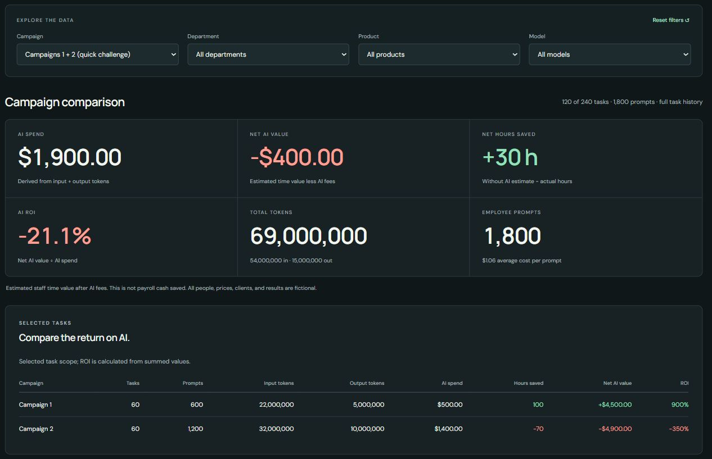
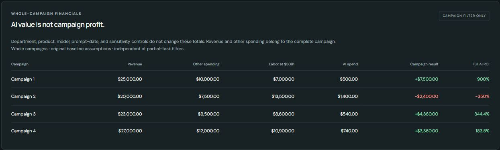

# Question 3: Net AI Value and Campaign Results

**After paying for AI, was estimated net value positive or negative for each campaign?**

## Direct Answer

Campaign 1 produces **+$4,500 estimated net AI value** and **900% AI ROI**. Campaign 2 produces **−$4,900** and **−350% AI ROI**. Their combined net AI value is **−$400**. The deeper all-company analysis is positive because Campaigns 3 and 4 add $3,220 of net value.

| Scope | Time value at $50/hour | AI cost | Net AI value | Aggregate AI ROI |
| --- | ---: | ---: | ---: | ---: |
| Campaign 1 | +$5,000 | $500 | +$4,500 | 900.00% |
| Campaign 2 | −$3,500 | $1,400 | −$4,900 | −350.00% |
| **Focal Campaigns 1+2** | **+$1,500** | **$1,900** | **−$400** | **−21.05%** |
| Campaign 3 — deeper track | +$2,400 | $540 | +$1,860 | 344.44% |
| Campaign 4 — deeper track | +$2,100 | $740 | +$1,360 | 183.78% |
| **All four campaigns** | **+$6,000** | **$3,180** | **+$2,820** | **88.68%** |

*Dashboard evidence: Campaigns 1 and 2 only, all departments, products, and models; original baseline, 120 tasks. The combined −$400 is the focal result, not the all-company result.*

An AI ROI below −100% is possible: Campaign 2 loses estimated staff time as well as paying AI fees. Calculate aggregate ROI from total net value divided by total AI spend. Averaging the two campaign ROIs would give the wrong answer.

## Deeper Analysis: Whole-Campaign Financial Results

Net AI value compares estimated time value with the AI bill. A campaign result also includes revenue and other campaign spending, so it addresses a different business question.

| Campaign | Revenue | Other spending | Actual labor at $50/hour | AI cost | Campaign result |
| --- | ---: | ---: | ---: | ---: | ---: |
| Campaign 1 | $25,000 | $10,000 | $7,000 | $500 | +$7,500 |
| Campaign 2 | $20,000 | $7,500 | $13,500 | $1,400 | −$2,400 |
| Campaign 3 | $23,000 | $9,500 | $8,600 | $540 | +$4,360 |
| Campaign 4 | $27,000 | $12,000 | $10,900 | $740 | +$3,360 |
| **All four** | **$95,000** | **$39,000** | **$40,000** | **$3,180** | **+$12,820** |

*Dashboard evidence: all four complete campaigns. Department, product, model, prompt-date, and sensitivity settings do not alter these financial totals. The dashboard's Full AI ROI column remains the original-baseline AI-value ratio; it is not campaign profit margin.*

For example, Campaign 1's $7,500 result is `$25,000 − $10,000 − (140 × $50) − $500`. Its separate $4,500 net AI value is `(240 − 140) × $50 − $500`. Revenue and other spending appear only in the first calculation; estimated baseline hours appear only in the second.

These campaign results use the supplied cost categories, including the $50/hour labor assumption. They are modeled campaign results, not a complete real company's financial statements. The Quick Challenge does not supply campaign financial inputs; this section uses the deeper dataset.

## Calculation and Validation

`Net AI value = hours saved × $50 − AI cost`. `AI ROI = total net AI value / total AI cost × 100`. `Campaign result = revenue − other campaign spending − actual hours × $50 − AI cost`.

The [campaign table](outputs/campaign_summary.csv) and [scope table](outputs/scope_summary.csv) retain full precision. The [validator](../TECHNICAL/scripts/validate_data.py) reconciles prompt costs and unique task hours independently; the [dashboard](../TECHNICAL/dashboard/metrics.mjs) restricts whole-campaign calculations to campaign selection. Revenue is counted once per campaign, and other spending excludes labor and AI charges.

**Business implication:** judge AI workflow efficiency and campaign commercial performance together, while keeping their formulas and scopes distinct.

[Next: Department analysis](04_department_analysis.md) · [Solution index](README.md)
