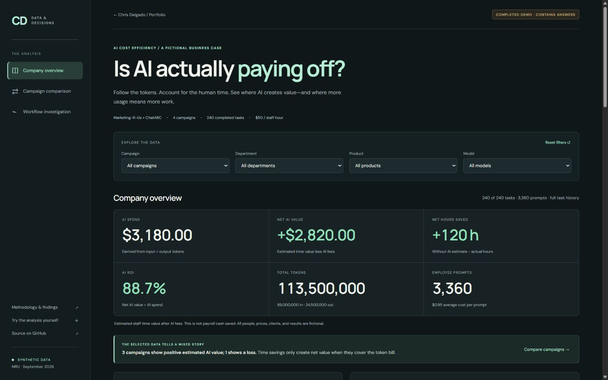
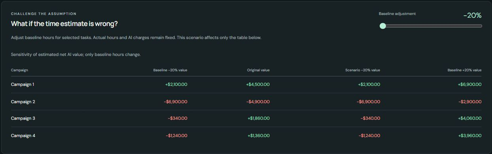

# Executive Summary

## Business Question

Does the estimated value of staff time saved cover AI fees, and which workflows should Marketing-R-Us keep or improve?

MRU is a fictional marketing company using the fictional ChatABC platform. This September 2026 case follows 240 completed tasks and 3,360 prompts across four campaigns. It values staff time at $50 per hour and includes preparation, prompting, review, and rework in actual effort. All data and prices are synthetic.

## Answer

**Keep useful AI workflows, but change the process around repeated corrections and model selection.** The company creates $2,820 of estimated net AI value, yet Campaign 2 loses $4,900. Campaign 1 creates $4,500, demonstrating that the company average masks opposite outcomes. Human effort accounts for $8,500 of their $9,400 net-value gap; higher AI charges account for the remaining $900.

*Dashboard evidence: all four campaigns, all departments, products, and models; original baseline. The $2,820 estimate is staff capacity value after AI fees, not payroll cash saved.*

## Headline Findings

| Measure | Campaign 1 | Campaign 2 | All four campaigns |
| --- | ---: | ---: | ---: |
| Completed tasks | 60 | 60 | 240 |
| AI spending | $500 | $1,400 | $3,180 |
| Baseline hours without AI | 240 | 200 | 920 |
| Actual hours with AI | 140 | 270 | 800 |
| Hours saved / lost | +100 | −70 | +120 |
| Estimated net AI value | +$4,500 | −$4,900 | +$2,820 |
| Aggregate AI ROI | 900.00% | −350.00% | 88.68% |
| Whole-campaign result | +$7,500 | −$2,400 | +$12,820 |

The focal two-campaign population has **−$400** combined net AI value. Adding Campaigns 3 and 4 produces the positive company total. The detailed answers label both populations explicitly.

1. **Higher spending does not guarantee value.** Campaign 2 uses 1,200 prompts versus Campaign 1's 600, spends $900 more, and requires 70 more hours than its own no-AI estimate. All of the spending increase comes from greater Pro usage at unchanged prices.
2. **Rework deserves attention.** Campaign 2 records 87.82 rework hours and 482 correction prompts, versus 10.74 hours and 68 corrections in Campaign 1. Changed briefs are Campaign 2's most frequent recorded issue: 27 of 60 tasks.
3. **The highest-spend department also leads focal value.** Creative spends $498.37 and creates $381.63 net AI value across Campaigns 1 and 2. The other three departments have negative net value in that same population.
4. **Campaign profit answers a different question.** Company campaign results total $12,820 after revenue, other spending, staff time, and AI fees. This is not the $2,820 incremental AI-value measure.
5. **Some benefits depend on the baseline estimate.** At 20% lower baseline hours, Campaigns 3 and 4 fall to −$340 and −$1,240. Campaign 1 remains positive and Campaign 2 remains negative across the ±20% range.

*Dashboard evidence: Campaigns 1 and 2, all departments, products, and models; original baseline. The 120 selected tasks match the Quick Challenge population.*

## Recommended Actions

| Priority | Action | Evidence | How to assess improvement |
| ---: | --- | --- | --- |
| 1 | Keep promising tasks and test a standard brief/template process, with a review point for repeated corrections | Campaign 2 has 87.82 rework hours; template use is 19/60 tasks versus 53/60 in Campaign 1 | Compare similar task types and acceptance criteria; measure total actual hours, correction counts, and rework share |
| 2 | Test model routing on routine work and validate no-AI baselines before expansion | Pro explains the full $900 extra bill; Campaigns 3 and 4 turn negative at a 20% lower baseline | Measure total token plus human cost at equivalent accepted quality; retain a comparable no-AI benchmark |

These are proposed tests, not proven savings. Campaign 1 contains eight negative-value tasks and Campaign 2 contains ten positive-value tasks, so the campaign label alone should not determine which work continues.

*Dashboard evidence: all four campaigns, all departments, products, and models; scenario baseline −20%. The table also shows original and +20% endpoints. Actual hours and AI fees remain fixed.*

## Limits and Reproducibility

The no-AI baseline is estimated, and time value is not payroll cash savings. Observed template use, model choice, and changed briefs can differ with campaign, task difficulty, and other conditions; this case does not prove causation. The data were deliberately calibrated to demonstrate an analytical method, not to measure any actual business or AI provider.

Published [CSV outputs](outputs/) reconcile with the dashboard and [exact controls](outputs/check_totals.json). Prompt costs are calculated before aggregation, task hours are counted once, and campaign revenue is counted once. Data generation, analysis, code, and documentation were prepared with Codex assistance.

[Open the dashboard](https://ai-cost-efficiency-860922042669.us-east1.run.app) · [Read the six detailed answers](README.md) · [Review the methodology](ANALYSIS.md)
