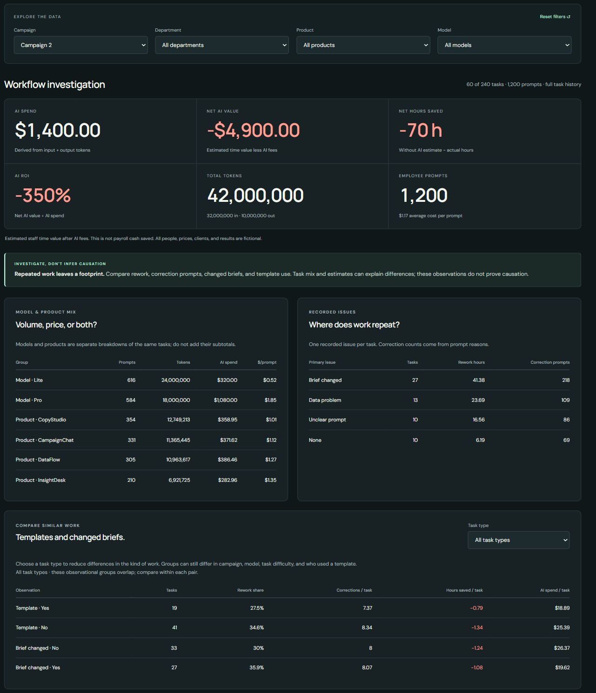

# Question 6: Strategic Recommendations

**Should MRU keep, change, or reduce how it uses AI? Give two actions supported by the numbers.**

## Recommendation

**Keep the workflows that show value, change the process around repeated work, and reduce unnecessary expensive-model usage through measured trials.** Avoid a company-wide decision based only on the total AI bill or average ROI.

The four campaigns collectively create $2,820 of estimated net AI value, but the focal comparison combines Campaign 1's +$4,500 with Campaign 2's −$4,900. Campaign 1 still contains eight negative-value tasks, and Campaign 2 contains ten positive-value tasks. Task-level selection matters.

*Dashboard evidence: Campaigns 1 and 2, all departments, products, and models; original baseline. Their $9,400 net-value gap comprises $8,500 of estimated time-value difference and $900 of additional AI fees.*

## Action 1: Improve the Brief, Template, and Correction Process

Use successful comparable tasks as candidates for a shared brief and prompt template. Add a review point when repeated corrections suggest that the brief, source data, or approach needs attention before more prompts are issued.

- **Evidence:** Campaign 2 records 87.82 rework hours and 482 correction prompts versus Campaign 1's 10.74 hours and 68 corrections. Changed briefs affect 27 of 60 Campaign 2 tasks; that group has 41.38 rework hours. Template use is 19 of 60 tasks versus 53 of 60 in Campaign 1.
- **Expected benefit:** less time spent resolving avoidable misunderstandings and repeating work, if the trial confirms the hypothesis. No dollar saving is promised from the observed association alone.
- **Test:** compare similar task types, the same acceptance criteria, and similar complexity with and without the proposed workflow. Capture preparation, prompting, review, corrections, and total actual hours. Avoid treating fewer prompts as success if quality falls or human review grows.
- **Success measures:** total effort per accepted task, rework share, corrections per task, token cost, and net AI value using a defensible baseline. Track quality during the trial; the supplied dataset contains no independent numerical quality score.

*Dashboard evidence: Campaign 2, all departments, products, models, and task types. The group patterns motivate a test; they do not establish causation.*

## Action 2: Test Model Routing and Verify the No-AI Benchmark

Try Lite on comparable routine work where it can meet the same acceptance criteria. Retain Pro where its full workflow result warrants it, and measure a credible no-AI benchmark before expanding apparently successful patterns.

- **Evidence:** the entire $900 extra AI bill in Campaign 2 comes from increased Pro token usage at unchanged prices. Yet Campaign 2's Lite and Pro cohorts both have negative net AI value: −$2,147 and −$2,753. A cheaper model alone would not resolve the observed increase in human effort.
- **Expected benefit:** avoid unnecessary premium-model spend while preserving work quality, and reduce decisions based on overoptimistic time estimates.
- **Test:** compare matched tasks across model options with the same review and acceptance process; maintain a comparable no-AI benchmark. Record token charges plus actual human effort, including any extra correction work.
- **Success measures:** combined human and AI cost per accepted task, measured baseline versus actual hours, and sensitivity of net AI value. Campaigns 3 and 4 fall to −$340 and −$1,240 at a 20% lower baseline, so their benefits should be verified before wider adoption.

## What Leadership Should Keep Watching

| Measure | Why it matters |
| --- | --- |
| Net AI value and hours saved by comparable task type | Reveals where AI use changes the full effort requirement |
| Rework share and correction prompts per task | Highlights repeated work that may warrant a process review |
| Input/output costs and model mix | Explains spending changes without confusing volume with price |
| Baseline sensitivity | Shows whether claimed benefits depend on uncertain estimates |
| Whole-campaign result | Tests commercial performance while keeping revenue at campaign grain |

## Limits and Validation

The recommendations combine [cost and model evidence](01_usage_and_costs.md), [sensitivity](02_time_saved.md), [value and campaign results](03_value_and_campaign_results.md), [department scope](04_department_analysis.md), and [workflow observations](05_workflow_investigation.md). All figures come from the published [source-derived tables](outputs/) and dashboard calculations; no projected intervention savings have been fabricated.

This is a synthetic, calibrated teaching case. Task difficulty, campaign mix, model choice, and estimated baselines can explain group differences. Staff time value is not realized cash savings, and observational patterns do not demonstrate causal impact.

[Executive summary](EXECUTIVE_SUMMARY.md) · [Solution index](README.md) · [Project README](../../../README.md)
