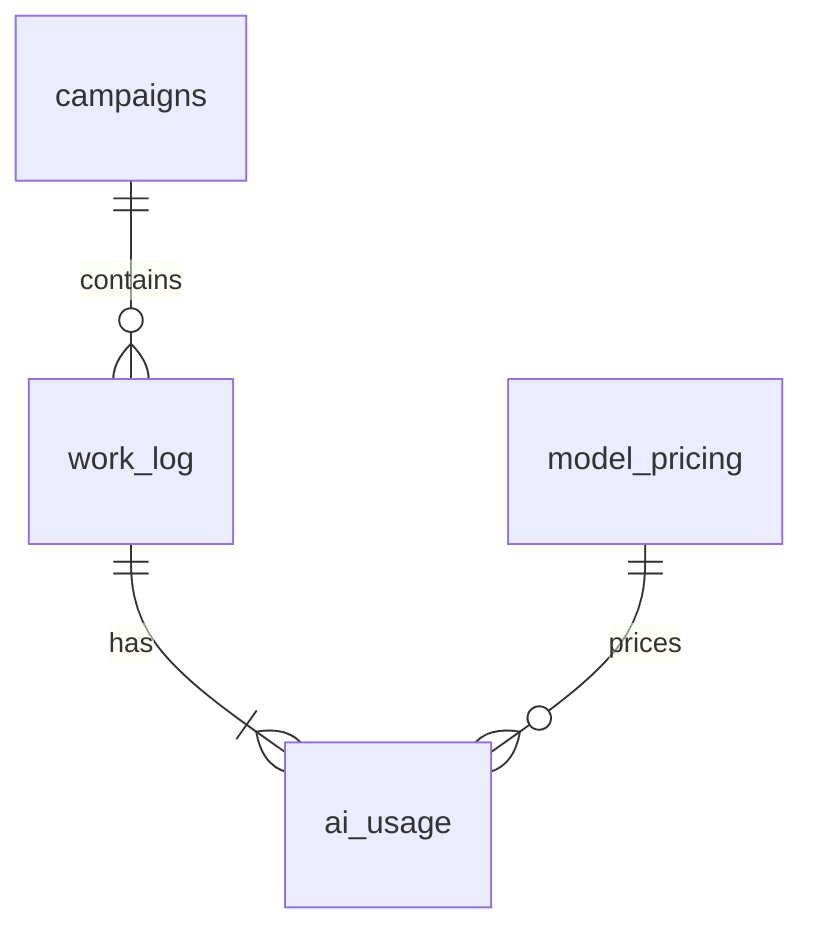

# Data dictionary

The canonical [data folder](../data/README.md) contains UTF-8 CSV files with headers. Dates use `YYYY-MM-DD`, currency uses USD, token counts are nonnegative integers, and hours are decimal values. All values are synthetic. Fixed model prices apply throughout September 2026; they are teaching assumptions rather than current provider prices.

## Relationships and grain

`work_log` must be deduplicated before it is used as a task dimension. `ai_usage.campaign_id` must match the linked task's campaign. Each task uses one model and one product in this dataset. Each model has one price row; each campaign has one financial row.

| Source | Raw rows | Intended key | What one analytical row represents |
| --- | ---: | --- | --- |
| [work_log.csv](../data/portfolio-project/work_log.csv) | 242 | `work_item_id` after exact deduplication | One of 240 completed tasks |
| [ai_usage.csv](../data/portfolio-project/ai_usage.csv) | 3,360 | `usage_id` | One employee prompt |
| [model_pricing.csv](../data/portfolio-project/model_pricing.csv) | 2 | `model` | One fictional model's fixed rates |
| [campaigns.csv](../data/portfolio-project/campaigns.csv) | 4 | `campaign_id` | One complete campaign |
| [mru_quick_challenge.csv](../data/quick-challenge/mru_quick_challenge.csv) | 122 | `work_item_id` after exact deduplication | One of 120 focal tasks, with prompts already aggregated |

## Work log

| Column | Type | Definition and constraint |
| --- | --- | --- |
| `work_item_id` | Text | Task key. Raw repeated exports must be identical before one is retained. |
| `completion_date` | Date | Task completion date in September 2026. It is distinct from prompt usage date. |
| `campaign_id` | Text | Foreign key to `campaigns`: C001, C002, C003, or C004. |
| `department` | Text | Content, Creative, Marketing Operations, or Analytics after trimming and case standardization. |
| `employee` | Text | Fictional employee responsible for the task. Eight employees, each in one department. |
| `task_type` | Text | Work description used to compare similar tasks, such as Write ad copy. |
| `baseline_hours` | Decimal hours | Estimated human effort for the same completed work at acceptable quality without AI. Nonnegative. |
| `actual_hours` | Decimal hours | Total human effort with AI, including preparation, prompting, review, and rework. Nonnegative. |
| `rework_hours` | Decimal hours | Portion of actual effort spent correcting or redoing work; between zero and `actual_hours`. |
| `issue_tag` | Text | None, Unclear prompt, Brief changed, or Data problem. |
| `brief_changed` | Text flag | `Yes` or `No`; an observed workflow condition. |
| `prompt_template_used` | Text flag | `Yes` or `No`; an observed workflow condition. |

## AI usage

| Column | Type | Definition and constraint |
| --- | --- | --- |
| `usage_id` | Text | Unique prompt key. Followups and corrections are separate prompts. |
| `usage_date` | Date | September 2026 prompt date, no later than the linked task's completion date. Use for daily spending. |
| `work_item_id` | Text | Foreign key to the cleaned work log. |
| `campaign_id` | Text | Must equal the linked task's campaign. |
| `product` | Text | CampaignChat, CopyStudio, DataFlow, or InsightDesk. One product per task. |
| `model` | Text | Lite or Pro; foreign key to model pricing. One model per task. |
| `input_tokens` | Integer | Tokens sent to AI, including context; nonnegative. |
| `output_tokens` | Integer | Tokens returned by AI; nonnegative. |
| `prompt_reason` | Text | First attempt, Followup, or Correction. Exactly one First attempt per task. |

The data contains no prompt text, personal information from real employees, or automated API calls. A prompt is one employee interaction in this exercise.

## Model pricing

| Column | Type | Definition |
| --- | --- | --- |
| `model` | Text | Unique Lite or Pro model key. |
| `input_rate_usd_per_million` | USD / million input tokens | Lite: 10. Pro: 40. |
| `output_rate_usd_per_million` | USD / million output tokens | Lite: 30. Pro: 100. |

Rates are shared across all four products. Calculate input and output spending separately, then sum; do not apply a single blended rate to total tokens.

## Campaigns

| Column | Type | Definition |
| --- | --- | --- |
| `campaign_id` | Text | Unique C001, C002, C003, or C004 key. |
| `campaign_name` | Text | Campaign 1, Campaign 2, Campaign 3, or Campaign 4. |
| `campaign_revenue_usd` | USD | Revenue for the complete campaign. |
| `other_campaign_cost_usd` | USD | Complete campaign spending excluding human time and AI fees. |

These financial amounts must each be counted once. They cannot be summed after expansion to tasks or prompts, or allocated to departments/products without an explicit allocation assumption.

## Quick Challenge file

This file contains Campaigns 1 and 2 from the deeper track. Its one-row-per-task design supports spreadsheet analysis without relational joins. The two raw duplicate task exports are shared with the deeper work log.

| Column | Type | Definition |
| --- | --- | --- |
| `work_item_id` | Text | Task key for deduplication and cross-track reconciliation. |
| `completion_date` | Date | Task completion date, using the work-log definition. |
| `campaign` | Text | Campaign 1 or Campaign 2 display name. |
| `department` | Text | Department; trim and standardize before grouping. |
| `employee` | Text | Fictional employee, using the work-log definition. |
| `product` | Text | Task's single product, from its prompt records. |
| `model` | Text | Task's single Lite or Pro model. |
| `task_type` | Text | Work description, using the work-log definition. |
| `prompt_count` | Integer | All employee prompts for this task, including followups and corrections. |
| `input_tokens` | Integer | Sum of input tokens across the task's prompts. |
| `output_tokens` | Integer | Sum of output tokens across the task's prompts. |
| `input_rate_usd_per_million` | USD / million input tokens | Applicable model input rate from model pricing. |
| `output_rate_usd_per_million` | USD / million output tokens | Applicable model output rate from model pricing. |
| `baseline_hours` | Decimal hours | Estimated no-AI effort, using the work-log definition. |
| `actual_hours` | Decimal hours | Total with-AI effort, already including rework. |
| `rework_hours` | Decimal hours | Subset of actual effort. |
| `issue_tag` | Text | Primary recorded issue, using the work-log categories. |

## Derived measures

These measures are calculated in the analysis; they are not supplied as learner answer columns. Use a common $50/hour time-value assumption for every employee.

| Measure | Formula |
| --- | --- |
| Input cost | Input tokens × input rate ÷ 1,000,000 |
| Output cost | Output tokens × output rate ÷ 1,000,000 |
| AI cost | Input cost + output cost |
| Hours saved | Baseline hours − actual hours |
| Estimated time value | Hours saved × $50 |
| Net AI value | Estimated time value − AI cost |
| AI ROI | Sum of net AI value ÷ sum of AI cost × 100 |
| Average cost per prompt | Sum of AI cost ÷ prompt count |
| Rework share | Sum of rework hours ÷ sum of actual hours × 100 |
| Whole-campaign result | Revenue − other spending − (actual hours × $50) − AI cost |

Aggregate underlying amounts before taking ratios. Preserve full precision until display and return N/A for a zero denominator. Net AI value estimates staff capacity value; it is not evidence of reduced payroll spending. For formulas and sensitivity instructions, use the [Portfolio Project formula guide](../learners/portfolio-project/FORMULAS.md).
