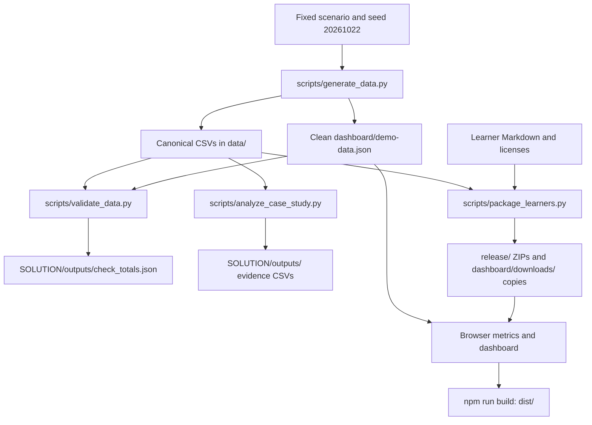

# Data pipeline and reproducibility

This repository contains a deterministic teaching dataset, an independent reconciliation step, a browser dashboard, and two offline learner packages. The canonical raw CSVs live in [`data/`](../data/README.md). The generated demo source contains cleaned records; the learner sources retain the small cleaning exercise.

## Flow



## Rebuild from the repository root

Python 3.10+ uses only its standard library. Node.js 22+ runs the dashboard tests and static build. No database, API credentials, or external data connection is needed.

```sh
python scripts/generate_data.py
python scripts/validate_data.py --write-checks
python scripts/analyze_case_study.py
python scripts/package_learners.py
python -m unittest discover -s tests -p "test_data.py" -v
npm test
python scripts/package_learners.py --check
npm run build
```

The Python scripts resolve files relative to their own location, so they can also be invoked using an absolute path from another directory. Run the npm commands from the repository root. Generation replaces the five canonical CSVs and `dashboard/demo-data.json`; analysis replaces the eight evidence CSVs; packaging replaces generated HTML and both release/hosting ZIP copies. Keep exploratory analysis in separate files.

## 1. Generate internally consistent sources

[`generate_data.py`](../scripts/generate_data.py) creates integer tokens and hundredths of hours before serialization. It uses seed `20261022` and largest-remainder apportionment to preserve the fixed scenario totals while varying individual tasks and prompts.

The generator emits 240 clean tasks, 3,360 prompts, two model prices, and four campaigns. The raw task exports intentionally add two repeated records and department whitespace/case inconsistencies. The quick export is limited to the same 120 Campaign 1/2 tasks and aggregates their prompt tokens and counts to task grain. It also includes model rates so learners can begin without a join.

`dashboard/demo-data.json` contains only clean original-column records in four arrays: `work_log`, `ai_usage`, `model_pricing`, and `campaigns`. It has no stored ROI or net-value answer fields. The browser calculates those metrics from the records.

## 2. Independently reconcile the records

[`validate_data.py`](../scripts/validate_data.py) reads the CSVs and demo source without importing the generator or treating saved check totals as an input. It checks:

- Raw and deduplicated row counts; exact duplicate equality and department normalization.
- Unique pricing, campaign, and usage keys; task/prompt/campaign relationships; supported categories; valid dates and nonnegative numbers.
- One product/model and one first attempt per task; all tasks having prompts.
- Rework within actual hours and task hours counted once.
- Token-based charges using `Decimal`, without rounding individual prompts to cents.
- Quick/deeper-track agreement and record-level parity between cleaned CSV sources and the dashboard source.
- Focal scenario controls, task-level exceptions, and baseline sensitivity.

`--write-checks` saves six-decimal monetary controls to [`SOLUTION/outputs/check_totals.json`](../SOLUTION/outputs/check_totals.json). Normal validation prints the calculated result without changing that file. Scenario details and answer values are in [`SOLUTION/CALIBRATION.md`](../SOLUTION/CALIBRATION.md).

The Python regression tests deliberately corrupt duplicate rows, prices, tokens, foreign keys, rework values, and demo records to establish that those errors are rejected. Dashboard tests separately exercise metric calculations and filter scope.

After validation, [`analyze_case_study.py`](../scripts/analyze_case_study.py) independently prices the canonical CSV records with `Decimal` and writes eight compact evidence tables under `SOLUTION/outputs/`: scope, campaign, department, issue, model, product, workflow, and sensitivity summaries. These support the completed case-study answers and retain their scope labels. They are excluded from learner packages.

## 3. Package the learner tracks

[`package_learners.py`](../scripts/package_learners.py) reads each track's canonical CSVs from `data/` and its four Markdown guides from `learners/`. An explicit filename and schema allowlist keeps completed analyses, scripts, tests, and calculated answer columns out of the archives.

Both ZIPs have a flat layout: CSV file(s), four Markdown guides, `START_HERE.html`, `LICENSE`, and `DATA_LICENSE`. The HTML works offline and is generated from the shipped Markdown. The repository HTML links to `../../data/<track>/`; the packaged HTML links to CSVs beside itself. Both resolve without duplicating editable source CSVs.

The packager normalizes text to UTF-8/LF, fixes ZIP timestamps and permissions, sorts entries, and stores entries without compression to avoid zlib-dependent bytes. It verifies the entry allowlist and CRC. The release archive and dashboard download copy are byte-identical. `--check` recomputes all outputs and fails if any are stale or missing.

## 4. Build and present the dashboard

[`dashboard/metrics.mjs`](../dashboard/metrics.mjs) prices prompts in integer microdollars and aggregates them to tasks before combining costs with human time. Totals and ratios are calculated at the selected scope and rounded for display. Rework remains part of actual hours.

Task filters retain each selected task's full prompt history. Daily spending uses prompt usage dates; that chart's date range does not allocate task hours or change task ROI. Whole-campaign financial results count revenue and other spending once and use only the campaign filter. Baseline sensitivity changes estimated no-AI hours while actual effort and AI spending remain fixed.

`npm run build` validates the clean task population and the learner download presence, then copies the dashboard to `dist/`. Hosting instructions are documented separately in [DEPLOYMENT.md](DEPLOYMENT.md).

## Continuous validation and limits

The [GitHub workflow](../.github/workflows/validate.yml) runs independent source reconciliation, Python regression tests, JavaScript tests, package freshness checks, and the static build. The checked-in data and downloads make both learning tracks usable without running a generator.

Deterministic generation and reconciliation establish internal consistency. They do not make this synthetic case a causal experiment, a real provider benchmark, a validated estimate of payroll savings, or a timed human learner pilot.
